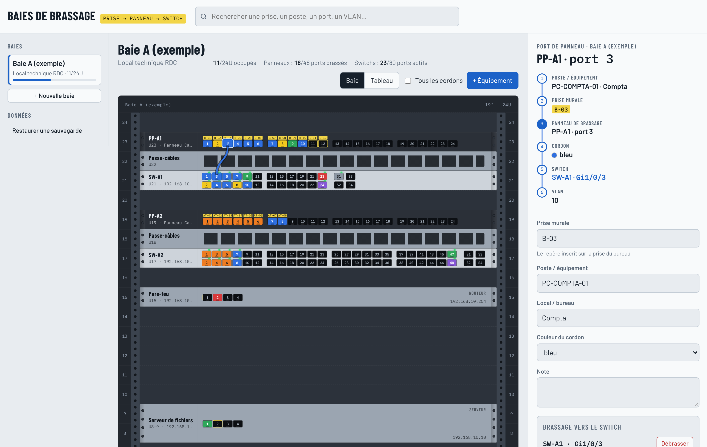
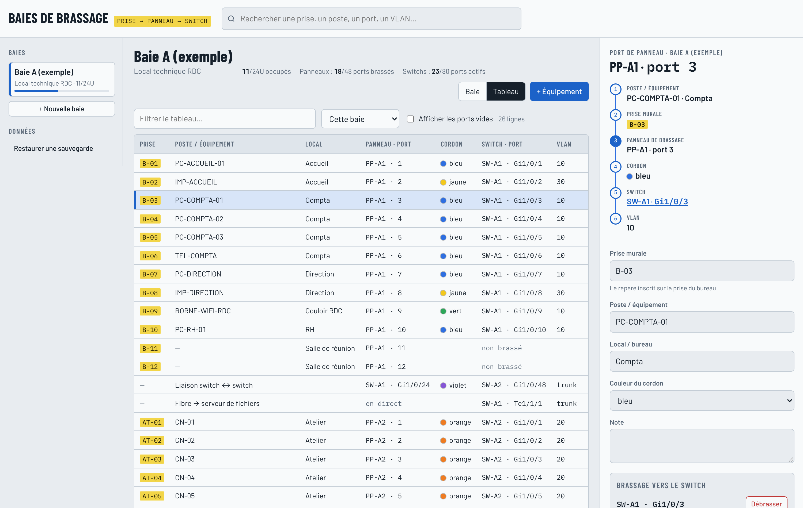
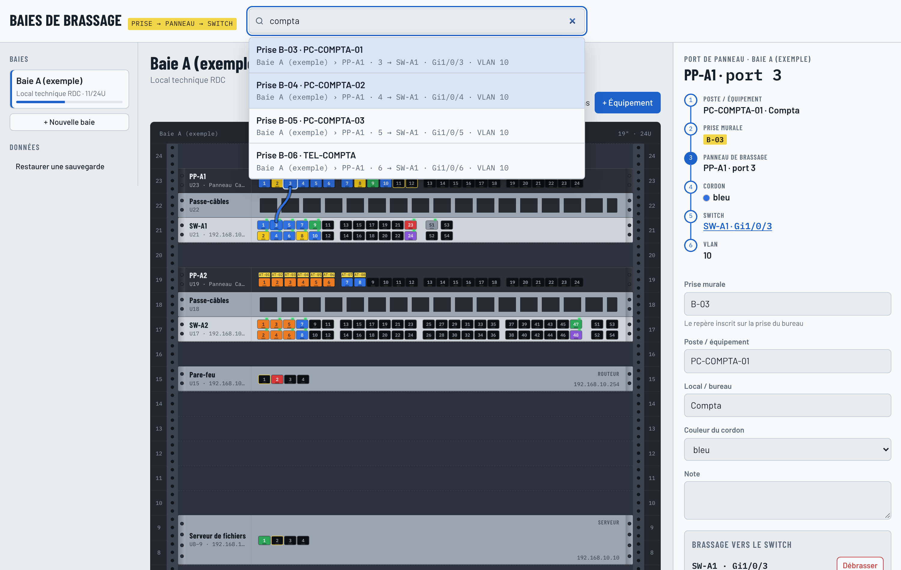

# Baies de brassage

Application de bureau Windows pour documenter la partie **physique** d'un réseau d'entreprise :
baies, panneaux de brassage, switchs, NAS, serveurs, routeurs et prises murales.

Elle répond à une question simple qu'un fichier Excel gère mal :
**cette prise murale arrive sur quel port de panneau, brassé vers quel port de switch, pour quel poste et quel VLAN ?**



> Les captures montrent uniquement la baie d'exemple fournie avec l'application (données fictives).

## Pourquoi cet outil

Le suivi du brassage se faisait dans un tableur : difficile à tenir à jour, impossible à visualiser,
et il fallait croiser plusieurs onglets pour retrouver d'où venait un câble.
L'objectif était un outil léger, hors ligne et sans serveur à installer, utilisable directement devant la baie.

## Fonctionnalités

- **Vue graphique de la baie à l'échelle (en U)** : placement des équipements par glisser-déposer.
- **Ports cliquables** : couleur du cordon, voyant pour les ports de switch actifs, cordon dessiné entre les deux ports.
- **Traçage complet d'un port** : poste → prise murale → panneau → cordon → switch → VLAN.
- **Brassage en deux clics**, avec avertissement si le port de destination est déjà occupé.
- **Liaisons switch ↔ switch** (trunk, cascade) et équipements réseau (NAS, serveur, routeur) reliés aux switchs.
- **Recherche globale** : une prise, un poste, un port, un VLAN.
- **Vue tableau** filtrable et **export CSV** prêt pour Excel.
- **Données dans un simple fichier JSON**, partageable sur un serveur de fichiers, avec copie de sauvegarde à chaque session et gestion des conflits d'écriture.
- **Mise à jour intégrée** depuis un dossier réseau (Fichier → Mettre à jour la version…).

| Vue tableau | Recherche |
|---|---|
|  |  |

## Technique

- **Electron** (processus principal + preload) et une interface en **HTML/CSS/JavaScript sans framework**.
- Sécurité Electron : `contextIsolation`, `sandbox`, pas de `nodeIntegration`, Content-Security-Policy stricte.
- Aucune ressource chargée depuis Internet : polices embarquées, fonctionne entièrement hors ligne.
- Écriture atomique du fichier de données (fichier temporaire puis renommage).
- Installeur NSIS « un clic » par utilisateur (pas de droits administrateur) et version portable, générés avec **electron-builder**.

## Lancer le projet

Prérequis : [Node.js LTS](https://nodejs.org) (`winget install OpenJS.NodeJS.LTS`).

```powershell
npm install        # une seule fois
npm start          # lance l'application en mode développement
npm run dist       # génère l'installeur et la version portable dans dist\
```

Au premier lancement, cliquer sur **Charger une baie d'exemple** pour découvrir l'outil.

Les exécutables ne sont pas signés : au premier lancement, Windows SmartScreen peut afficher
« Windows a protégé votre ordinateur ». Cliquer sur **Informations complémentaires → Exécuter quand même**.

## Où sont les données ?

Par défaut dans `Documents\Baies de brassage\baies-brassage.json`.
**Fichier → Enregistrer sous…** permet de les placer ailleurs, par exemple sur un partage réseau.
L'application est pensée pour **une personne qui modifie à la fois**.

## Structure

| Fichier | Rôle |
|---|---|
| `main.js` | Processus principal Electron : fenêtre, menu, lecture/écriture du fichier JSON, mise à jour |
| `preload.js` | Pont sécurisé entre l'interface et `main.js` (`window.desktop`) |
| `src/index.html` | Toute l'interface (HTML, CSS, JavaScript) |
| `src/fonts/` | Polices embarquées (fonctionne hors ligne) |
| `build/` | Icônes de l'application |
| `docs/` | Captures d'écran |

## Auteur

Donovan Faglain, administrateur systèmes et réseaux.
